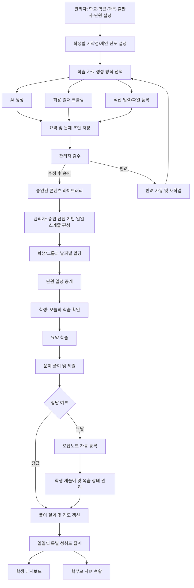

# Daily Study 학습 콘텐츠 운영 및 학습 프로세스

## 1. 목적과 핵심 원칙

Daily Study는 매일 학생에게 학습 데이터를 제공하고, 학생이 과목별 학습과 문제 풀이를 이어가며 진도를 나가도록 돕는 서비스입니다.

- 관리자는 학습 자료를 준비하고 검수·승인한 뒤, 학생 또는 학생 그룹에 일일 학습 스케줄을 편성·할당합니다.
- 관리자는 중·고등학교의 학교·학년·적용 연도별 과목, 교과서 출판사와 단원 구성을 관리합니다.
- 단원별 스케줄은 학교별 교과서 단원 체계에 맞춰 편성하고 학생에게 할당합니다.
- 학기 중간에 시작하는 학생은 개인 학습 진도에서 시작 단원을 지정하며, `skip`은 해당 학생의 개인 진도에만 반영합니다.
- 학습 자료는 AI 생성, 허용된 출처의 크롤링, 관리자 직접 입력으로 만듭니다. 주요 산출물은 학습 요약과 문제입니다.
- 학생은 날짜별 학습 목록에 따라 요약을 학습하고 문제를 풉니다.
- 오답은 자동으로 오답노트에 쌓이며, 학생은 다시 풀고 복습 상태를 관리합니다.
- 학습 활동과 결과를 진도·성취도로 집계해 학생과 권한이 있는 학부모에게 제공합니다.
- 승인되지 않은 자료는 학생에게 노출하지 않습니다. 콘텐츠 승인과 학습 일정 공개는 서로 구분된 단계입니다.

## 2. 역할과 책임

| 역할 | 주요 책임 | 접근 범위 |
|---|---|---|
| 관리자 (ADMIN) | 과목·단원 및 학습 콘텐츠 관리, AI/크롤링/직접 입력 생성, 자료 검수·승인·반려, 학습 스케줄 작성·할당·공개, 운영 현황 확인 | 시스템 관리 및 전체 콘텐츠·할당 관리 |
| 학생 (STUDENT) | 매일 할당된 학습 확인, 요약 학습, 문제 풀이, 결과 확인, 오답노트 복습 및 상태 관리 | 본인에게 공개된 일정과 본인 학습 기록 |
| 학부모 (PARENT) | 연결된 학생의 과목별 진도와 성취도 확인 | 연결 관계가 확인된 자녀의 읽기 전용 데이터 |

## 3. 전체 프로세스



## 4. 관리자 프로세스와 화면

관리자 작업은 `콘텐츠 준비 → 검수 승인 → 스케줄 편성 → 할당·공개 → 운영 모니터링` 순으로 진행합니다. 콘텐츠의 승인 상태와 스케줄 상태를 별도로 관리해야 합니다. 예를 들어 콘텐츠가 승인돼도 아직 일정에 편성되지 않았을 수 있습니다.

### 4.1 관리자 메뉴 구조 제안

```text
관리자
├── 운영 대시보드
├── 학습 데이터 관리
│   ├── 요약 콘텐츠 목록
│   ├── 문제 목록
│   ├── 학습 세트 목록
│   ├── 콘텐츠 생성
│   │   ├── AI 생성
│   │   ├── 크롤링 가져오기
│   │   └── 직접 입력/파일 등록
│   └── 검수 대기 / 승인 이력 / 반려함
├── 학습 스케줄
│   ├── 스케줄 캘린더
│   ├── 일일 학습 편성
│   ├── 학생/그룹 할당
│   └── 공개·수정·취소 이력
├── 학교·교육과정
│   ├── 학교 관리
│   ├── 학교/학년별 과목·출판사 편성
│   └── 교과서 단원 매핑
├── 개인 학습 진도
│   ├── 학생별 시작 단원
│   ├── 단원별 진도 설정
│   └── skip/복구 이력
├── 학생 및 학부모 관리
└── 성과·운영 통계
```

### 4.2 화면별 기능

| 화면 | 화면 구성 및 주요 동작 |
|---|---|
| 운영 대시보드 | 오늘 공개할 일정, 검수 대기 자료, 할당 완료율, 학생 학습 진행률, 실패한 생성·수집 작업을 요약합니다. |
| 학습 데이터 목록 | 요약·문제·학습 세트를 유형, 과목, 단원, 출처(AI/크롤링/직접 입력), 상태, 생성일, 작성자로 검색·필터링합니다. |
| 콘텐츠 생성 | 과목·단원·학년/수준·난이도·목표 학습량을 지정한 뒤 AI 생성, 크롤링 수집, 직접 작성 또는 파일 등록 방식을 선택합니다. 생성 결과는 즉시 학생에게 노출하지 않고 검수 대기 상태로 저장합니다. |
| AI 생성 작업 | 요약 길이·학습 목표와 문제 유형·문항 수·난이도를 입력합니다. 생성 진행 상태와 오류를 확인하고 결과를 편집해 검수 요청할 수 있습니다. |
| 크롤링 가져오기 | 출처 URL 또는 등록된 수집 소스와 대상 과목·단원을 지정합니다. 수집 결과의 출처·중복·정제 상태를 확인하고 저작권·출처 정책에 맞는 항목만 검수 대상으로 등록합니다. |
| 직접 입력/파일 등록 | 요약 본문과 문제, 보기, 정답, 해설, 태그를 직접 작성하거나 지원 형식의 파일로 올립니다. 필수 항목과 형식 오류를 저장 전에 안내합니다. |
| 콘텐츠 검수 상세 | 요약과 문제를 미리 보고 정확성, 과목·단원 적합성, 난이도, 정답·해설, 중복 여부를 확인합니다. 수정 후 승인하거나 반려 사유를 남깁니다. 여러 건을 일괄 승인할 때도 검수 대상과 결과를 명확히 보여줍니다. |
| 학습 세트 편집 | 한 날짜의 학습 단위로 요약, 문제 묶음, 순서, 예상 소요 시간을 구성합니다. 필요한 경우 한 단원에 여러 학습 블록을 배치합니다. |
| 스케줄 캘린더 | 날짜별 학습 세트, 대상 학생/그룹, 공개 상태와 준비 상태를 확인합니다. 일일 또는 반복 일정을 생성하고 충돌·미승인 콘텐츠 포함 여부를 알립니다. |
| 일정 할당 및 공개 | 대상 학생/그룹, 학습 날짜, 마감 시각(선택), 시간대, 공개 시점을 설정합니다. 미리보기 후 할당을 저장하고 공개합니다. 공개 전 수정·취소와 공개 후 변경의 적용 기준을 구분합니다. |
| 일정 상세/운영 현황 | 해당 일정의 대상·콘텐츠·진행률·완료율·문제 정답률을 확인합니다. 누락이나 오류를 찾아 일정 조정 또는 재할당을 수행합니다. |
| 학교·교육과정 관리 | 중학교/고등학교, 학교, 학년, 적용 연도·학기별 과목을 편성하고 과목마다 출판사·교과서 판본과 단원 구조를 연결합니다. 같은 과목의 학교별 차이를 보존합니다. |
| 교과서 단원 매핑 | 공통 과목·학습 목표와 학교별 교과서 단원을 연결하고 매핑 누락·중복을 확인합니다. |
| 개인 학습 진도 설정 | 학생별 학교·학년·출판사·단원을 확인하고 시작 단원을 지정합니다. 중간 합류 학생은 이전 단원을 진단, 완료 확인 또는 skip으로 설정합니다. skip은 이 화면에서만 해당 학생에게 적용하며 사유와 이력을 남기고 복구할 수 있습니다. |
| 학생 및 학부모 관리 | 계정 역할과 학생-학부모 연결을 관리합니다. 학부모에게는 연결된 학생의 데이터만 보이도록 관계와 접근 권한을 확인합니다. |

### 4.3 자료 검수와 상태

콘텐츠 상태와 할당 상태는 분리합니다.

```text
콘텐츠 상태: DRAFT → PENDING_REVIEW → APPROVED → ARCHIVED
                              └──────→ REJECTED → 수정 후 재검수

스케줄 상태: DRAFT → SCHEDULED → PUBLISHED → IN_PROGRESS → COMPLETED
                               └────────────→ CANCELLED
```

- `DRAFT`: 작성 또는 생성 중이며 검수 요청 전입니다.
- `PENDING_REVIEW`: 관리자의 검수 대기 상태입니다.
- `APPROVED`: 콘텐츠 내용이 승인됐으며 일정 편성에 사용할 수 있습니다.
- `REJECTED`: 반려 사유를 확인하고 수정 후 다시 검수를 요청해야 합니다.
- `SCHEDULED`: 승인 콘텐츠로 일정을 편성했지만 학생에게 아직 공개하지 않았습니다.
- `PUBLISHED`: 학생에게 학습 일정이 공개됐습니다.
- `IN_PROGRESS`: 대상 학생이 하나 이상의 학습 항목을 시작했습니다.
- `COMPLETED`: 일정 완료 조건을 충족했습니다. 완료 기준은 설정 가능한 정책으로 둡니다.
- `CANCELLED`: 일정 공개 전 또는 운영 정책에 따라 취소된 상태입니다.

승인 후 콘텐츠를 수정할 때는 이미 공개된 일정과 학생 풀이 이력에 영향을 주지 않도록 버전 또는 수정본 처리 규칙을 마련해야 합니다. 문제 정답을 변경하는 경우 기존 결과의 재채점 여부도 정책으로 정합니다.

## 5. 학생 프로세스와 화면

### 5.1 학생 메뉴 구조 제안

```text
학생
├── 오늘의 학습
│   ├── 오늘 학습 목록
│   ├── 학습 요약
│   ├── 문제 풀이
│   └── 오늘 결과
├── 학습 일정 / 캘린더
├── 과목별 진도
├── 오답노트
├── 학습 기록·성취도
└── 마이페이지
```

### 5.2 화면별 기능

| 화면 | 화면 구성 및 주요 동작 |
|---|---|
| 오늘의 학습 대시보드 | 오늘 날짜, 과목별 할당 학습, 예상 소요 시간, 완료·진행·미시작 상태를 보여줍니다. 학생이 바로 이어서 학습할 다음 항목을 제공하고 지난 일정도 확인할 수 있습니다. |
| 오늘 학습 상세 | 오늘 할당된 학습 세트를 순서대로 나열합니다. 요약 읽기, 문제 풀기, 오답 복습 등 각 항목의 완료 상태와 진행률을 보여줍니다. 학생은 관리자 설정을 벗어난 콘텐츠를 임의로 생성하는 대신 공개된 자료를 학습합니다. |
| 학습 요약 | 과목·단원·학습 목표를 표시하고 요약 본문을 읽기 쉬운 구획으로 제공합니다. 학습 완료 표시와 핵심 내용 확인을 지원합니다. 완료 판정은 단순 열람 또는 확인 동작 등 정책으로 정합니다. |
| 문제 풀이 | 문항, 보기/답안 입력, 현재 문항 수, 남은 문항, 임시 진행 상태를 보여줍니다. 답안을 제출하면 채점 결과와 해설을 안내합니다. 한 번 제출한 답을 수정할 수 있는지 여부는 문제 유형별 정책으로 정합니다. |
| 학습 결과 | 정답 수, 오답 수, 정답률, 소요 시간, 과목·단원 진도 변화를 보여줍니다. 오답은 오답노트에 저장되었음을 알리고 바로 복습으로 이동할 수 있습니다. |
| 일정·캘린더 | 날짜별 배정 학습과 완료 여부를 보여줍니다. 미래 일정은 공개된 범위에서 미리 볼 수 있고, 완료하지 못한 학습은 미완료 상태로 남깁니다. 미완료 학습의 이월 규칙은 운영 정책으로 정합니다. |
| 과목별 진도 | 과목 → 단원 → 할당된 학습 세트 순서로 진도율과 학습 이력을 확인합니다. 완료/미완료 기준과 최근 학습일을 분명히 표시합니다. |
| 오답노트 | 틀린 문제를 자동 수집하고 과목·단원·날짜·복습 상태로 필터링합니다. 문제와 내 답, 정답, 해설, 처음 틀린 날짜 및 재풀이 기록을 제공합니다. |
| 오답 재풀이 | 오답노트에서 문제를 다시 풀고 결과를 기록합니다. 정답을 맞혀도 기록은 보존하고 복습 완료 또는 재확인 필요 상태로 갱신합니다. 반복 오답은 다시 복습 대기 상태로 둡니다. |
| 학습 기록·성취도 | 일별 학습 시간, 완료한 일정, 풀이 수, 정답률 추이를 기간·과목별로 확인합니다. 점수만으로 진도를 대체하지 않고, 콘텐츠 완료와 문제 풀이 결과를 함께 보여줍니다. |

### 5.3 학생 학습 진행 상태

```text
할당됨 → 시작함 → 요약 학습 완료 → 문제 풀이 진행 → 제출/채점 완료
                                                ├─ 정답: 진도 반영
                                                └─ 오답: 오답노트 등록 → 재풀이/복습
일정 완료 조건 충족 → 완료
```

문제 풀이 중 앱이 닫히거나 연결이 끊길 수 있으므로, 진행 상태 임시 저장 여부와 재접속 시 이어 풀기 정책을 정의합니다. 한 문제의 풀이 기록은 원본 학습 일정·학습 세트·문제와 연결해 결과 추적이 가능해야 합니다.

### 5.4 학교별 교육과정과 개인별 시작점

학생 학습 경로는 `학교 → 학교급 → 학년 → 적용 연도/학기 → 과목 → 출판사/교과서 판본 → 단원`으로 결정합니다. 학교와 적용 연도에 따라 동일 과목의 출판사 및 단원 구조가 달라질 수 있으므로 편성을 각각 보존하고 학생 프로필에 해당 편성을 연결합니다.

학기 중간에 시작하는 학생은 개인 학습 진도 설정에서 시작 단원을 지정합니다. 시작 이전 단원은 진단, 완료 확인 또는 `SKIPPED`로 기록할 수 있습니다. skip은 해당 학생의 진행 목록에서만 단원을 제외하며 공통 단원 스케줄과 다른 학생에게는 영향을 주지 않습니다.

권장 진도 표시는 `학습 완료율`과 `진도 처리율`을 구분합니다. 기본 정책은 skip 단원을 완료로 간주하지 않고 학습 완료율 분모에서 제외하며 skip 수를 별도 표시하는 것입니다. 성취도는 실제 학습·풀이 결과에 근거하고 skip을 성취로 계산하지 않습니다. 개인 진도 변경은 이전 상태, 변경자, 사유, 시각을 이력으로 남깁니다.

## 6. 학부모 결과 확인 화면

학부모는 학습을 대신 수행하거나 답안을 수정하지 않고, 연결된 자녀의 진행 상황과 결과를 읽기 전용으로 확인합니다.

| 화면 | 화면 구성 및 주요 동작 |
|---|---|
| 자녀 현황 | 자녀 선택, 오늘 학습 완료율, 진행 중·미완료 일정, 최근 학습일을 확인합니다. |
| 과목별 진도 | 과목·단원·일일 일정별 완료 여부, 최근 학습 기록, 미완료 항목을 확인합니다. |
| 성취도 | 기간·과목별 문제 풀이 수, 정답률, 추이, 오답 복습 상태를 확인합니다. 집계 기간과 완료 기준을 표시합니다. |
| 학습 기록 | 날짜별 학습 시간, 학습 완료와 문제 결과를 살펴봅니다. 부모-학생 연결이 확인된 자녀의 데이터만 제공합니다. |

## 7. 핵심 데이터 연결 관계

```text
과목/단원
  └── 학습 콘텐츠(요약, 문제)
        ├── 출처: AI / CRAWL / MANUAL
        ├── 콘텐츠 버전 및 승인 이력
        └── 학습 세트
              └── 일정(날짜, 대상 학생/그룹, 공개 상태)
                    └── 학생별 학습 진행
                          ├── 요약 완료 기록
                          ├── 문제 풀이/채점 기록
                          └── 오답노트 및 재풀이 기록
                                └── 진도·성취도 집계
                                      └── 학생/연결된 학부모 조회
```

최소한 다음 식별자를 관계에 보존해야 결과를 올바르게 집계할 수 있습니다: `student_id`, `schedule_id`, `learning_set_id`, `content_id`와 버전, `subject_id`, `unit_id`, `quiz_id`, 풀이 시각 및 결과. 한 콘텐츠를 여러 학생이나 일정에 재사용해도 학생별 진행 기록은 서로 독립적으로 저장합니다.

## 8. 권한별 화면 접근 요약

| 기능 | 관리자 | 학생 | 학부모 |
|---|---|---|---|
| AI/크롤링/직접 입력 콘텐츠 생성 | 가능 | 불가 | 불가 |
| 콘텐츠 편집·검수·승인·반려 | 가능 | 불가 | 불가 |
| 일일 스케줄 작성·할당·공개·취소 | 가능 | 불가 | 불가 |
| 공개된 본인 학습 일정 조회 | 운영 전체 | 가능 | 연결된 자녀 일정 읽기 |
| 요약 학습 및 문제 풀이 | 검수 확인 목적 | 가능 | 불가 |
| 오답노트 조회·재풀이·복습 상태 변경 | 운영상 조회 정책에 따름 | 본인 데이터 가능 | 읽기 전용 조회 |
| 개인 진도·성취도 | 운영 통계 | 본인 데이터 | 연결된 자녀 데이터 읽기 |
| 학교별 과목·출판사 편성 | 전체 관리 | 본인 편성 조회 | 연결 자녀 편성 조회 |
| 개인 시작점·단원 skip | 운영/설정 | 본인 진도 설정 또는 요청 | 연결 자녀 상태 조회 |
| 학생/학부모 관계 및 계정 관리 | 가능 | 불가 | 본인 연결 요청·확인 범위 |

라우트에서 메뉴를 숨기는 것만으로 권한을 보장하지 않습니다. 서버는 매 요청에서 역할, 요청 대상 학생과 연결 관계, 콘텐츠 승인 상태 및 일정 공개 상태를 검증해야 합니다.

## 9. 기존 아키텍처와의 연결 및 확장 항목

`architecture.md`에 이미 정의된 요소를 활용할 수 있습니다.

- 관리자 문제 생성 방식: AI, 크롤링, 직접 입력, Excel/CSV 업로드
- 문제 승인 상태: `PENDING`, `PUBLISHED`, `REJECTED` 및 승인·반려 API
- 학생 문제 제공: 승인된 문제만 조회
- 풀이 및 오답: 풀이 기록, 채점 서비스, 오답노트 서비스·화면
- 요약: 단원별 요약 조회와 AI 요약 생성 API
- 학습 기록/통계: 대시보드, 주간·월간 통계, 학습 기록 및 캘린더 API

다음 기능은 새 운영 목표를 충족하기 위해 아키텍처에 추가할 설계 항목입니다.

1. **학습 세트**: 여러 승인 요약·문제를 하루의 학습 단위로 묶고 순서와 예상 학습량을 정의합니다.
2. **스케줄/할당**: 날짜·반복 규칙·학생/그룹 대상·공개 시각·마감·상태를 저장하고, 관리자 화면에서 편성·미리보기·공개하도록 합니다.
3. **승인 대상 확장**: 현재 API 상세는 문제 검수에 집중돼 있으므로 요약도 동일한 검수 워크플로를 거치는지 결정하고 상태·API를 설계합니다. 콘텐츠 단위 승인과 학습 세트/일정 공개 승인의 책임을 명확히 합니다.
4. **오답노트 API와 복습 상태**: 기존 도메인 서비스는 있지만 명시된 API 표가 부족합니다. 오답 목록, 필터, 재풀이 제출, 복습 완료/재확인 상태 변경 및 이력 API가 필요합니다.
5. **진도 정의**: 요약 학습 완료, 문제 세트 제출, 오답 복습을 진도율에 어떻게 반영할지 정합니다. 진도율은 할당된 학습 항목을 기준으로 계산해야 합니다.
6. **학부모 데이터 접근**: 자녀 연결·동의·연결 해제 모델 및 자녀별 진도·성취도 조회 API를 설계합니다.
7. **재할당 및 일정 변경 규칙**: 공개된 일정의 수정, 취소, 미완료 학습 이월, 학생 전학/그룹 변경 시 처리 기준을 정합니다.

## 10. MVP 구현 순서 제안

1. 중·고등학교, 학교·학년·적용 연도별 과목·출판사·교과서 단원 체계와 사용자 권한을 확정합니다.
2. 요약·문제 콘텐츠를 AI/크롤링/직접 입력으로 만들고 저장하는 기능을 구현합니다.
3. 생성된 자료의 검수 대기 목록, 상세 확인, 수정, 승인·반려와 이력을 구현합니다.
4. 승인 자료를 묶는 학습 세트와 날짜별 스케줄 편성·학생 할당·공개를 구현합니다.
5. 학생의 오늘 학습, 요약 보기, 문제 풀이·제출·채점과 진행 상태를 구현합니다.
6. 오답 자동 등록, 오답노트 목록, 재풀이와 복습 상태 관리를 구현합니다.
7. 학생 진도·성취도 집계와 학부모 읽기 화면을 연결합니다.
8. 관리자 운영 현황과 학부모 자녀 연결·권한 확인을 보강합니다.
9. 학생별 시작 단원, 중간 합류 진단, 개인 단원 skip/복구와 진도율 계산 규칙을 구현합니다.

## 참고 문서

- `architecture.md` — API 엔드포인트, AI/크롤링 파이프라인, 데이터베이스 모델, 프론트엔드 라우터, 개발 단계
- `메뉴구조도.md` — 역할별 메뉴와 접근 권한
