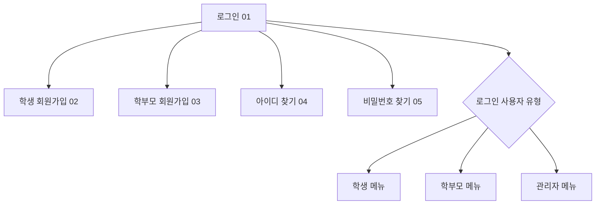
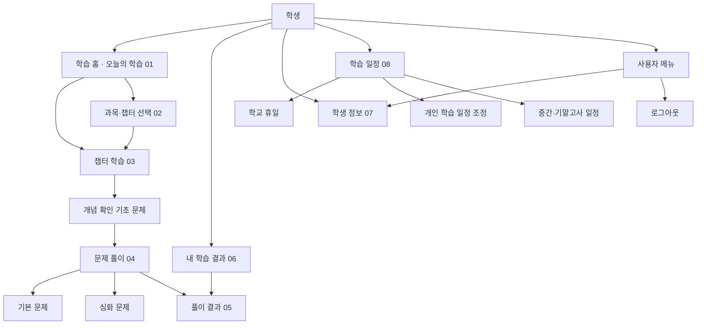
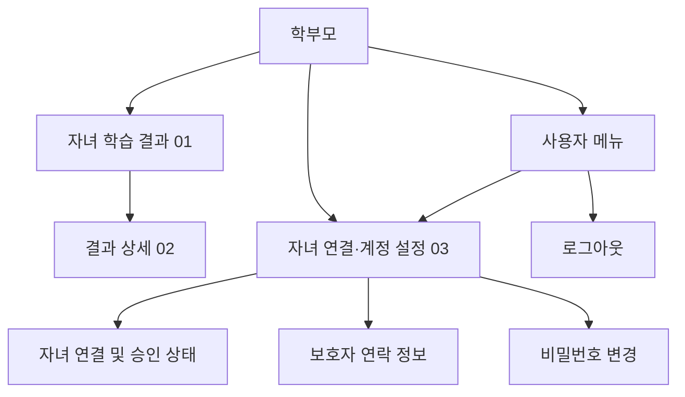
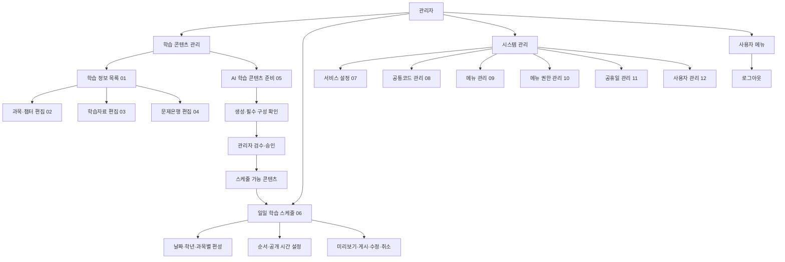

# Daily Study 메뉴 구조도

화면 콘텐츠 기획의 학생·학부모·관리자 기능을 기준으로 메뉴 계층을 정리했다. 화면 번호는 [11_화면컨텐츠.md](11_화면컨텐츠.md)의 Index와 동일하게 표기한다. 로그인 전 메뉴는 공통으로 제공하고, 로그인 후에는 역할에 맞는 메뉴만 노출한다.

## 로그인 전 공통 메뉴

## 학생 메뉴

학생 메뉴는 로그인 직후 오늘 학습을 가장 먼저 보여준다. 과목·챕터 학습은 오늘 배정된 콘텐츠에서 이어지며, 과목을 직접 선택하는 경로도 제공한다.

## 학부모 메뉴

학부모에게는 자녀의 풀이 날짜·과목·챕터·점수만 제공한다. 답안과 상세 오답 분석은 기본 메뉴에서 제공하지 않는다.

## 관리자 메뉴

관리자는 콘텐츠를 준비·검수·승인한 뒤에만 일일 스케줄에 편성할 수 있다. 서비스 운영 메뉴는 기준정보, 메뉴·권한, 휴일, 사용자 관리로 묶는다.

## 역할별 메뉴 요약

| 역할 | 메뉴 | 화면내용 | 화면 index |
|---|---|---|---:|
| 학생 | 학습 홈 | 오늘의 학습 확인·시작 → 개념 학습·기초 확인 → 기본/심화 문제 풀이 → 풀이 결과 확인 | 01, 03, 04, 05 |
| 학생 | 과목·챕터 선택 | 과목·챕터 선택 → 개념 학습·기초 확인 → 기본/심화 문제 풀이 → 풀이 결과 확인 | 02, 03, 04, 05 |
| 학생 | 내 학습 결과 | 날짜별 학습 기록 확인 → 선택 기록의 풀이 결과 확인 | 06, 05 |
| 학생 | 학생 정보 | 학생 이름, 학교명, 학년 확인·수정 | 07 |
| 학생 | 학습 일정 | 학교 휴일, 개인 학습 일정, 중간·기말고사 일정 관리 | 08 |
| 학부모 | 자녀 학습 결과 | 자녀 풀이 기록 목록 → 선택 기록의 결과 상세 확인 | 01, 02 |
| 학부모 | 계정 설정 | 자녀 연결·승인 상태, 보호자 연락 정보, 비밀번호 관리 | 03 |
| 관리자 | 학습 콘텐츠 관리 | 학습 정보 조회, 과목·챕터 편집, 학습자료 편집, 문제은행 편집, AI 콘텐츠 준비·검수·승인 | 01, 02, 03, 04, 05 |
| 관리자 | 일일 학습 스케줄 | 승인된 콘텐츠를 날짜·학년·과목별로 편성하고 게시·수정·취소 | 06 |
| 관리자 | 서비스 설정 | 공지, 점검 모드, 가입 허용 등 서비스 기본 설정 관리 | 07 |
| 관리자 | 공통코드 관리 | 공통 코드 그룹과 코드값 관리 | 08 |
| 관리자 | 메뉴 관리 | 메뉴 계층, 메뉴명, 경로, 정렬 순서와 사용 여부 관리 | 09 |
| 관리자 | 메뉴 권한 관리 | 역할별 메뉴 접근 및 조회·등록·수정·삭제 권한 관리 | 10 |
| 관리자 | 공휴일 관리 | 법정 공휴일과 임시 휴무일 관리 | 11 |
| 관리자 | 사용자 관리 | 사용자 계정, 역할, 상태와 학생·보호자 연결 관계 관리 | 12 |

## 메뉴 노출 및 접근 원칙

- 로그인 후 사용자 역할에 맞는 메뉴만 노출하고, 권한이 없는 메뉴 경로는 직접 접근도 차단한다.
- 학생의 오늘 학습은 관리자가 게시한 해당 날짜 스케줄을 기준으로 자동 구성한다.
- AI 콘텐츠는 필수 학습자료·문제·정답·해설이 준비되고 관리자 검수·승인된 경우에만 스케줄에 편성한다.
- 학생의 일정 조정은 개인 일정에 적용하며 콘텐츠의 관리자 승인 상태나 게시 내용을 변경하지 않는다.
- 사용자 이름 메뉴에서 개인정보 수정과 로그아웃을 제공한다. 학생의 개인정보 수정은 학생 정보 07로 연결한다.
